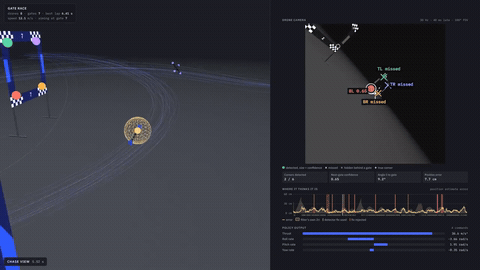

# Gate Race Sim

A small, fast, noise-free quadrotor racing simulator with TF-Agents PPO training.
It is modelled on the training setup of *Swift* (Kaufmann et al., Nature 2023), with the
messy parts (sensor noise, residual models, camera images) left out on purpose.

## Install

TF-Agents does not support Python 3.13 yet, so use 3.10 or 3.11:

```bash
python3.11 -m venv .venv && source .venv/bin/activate
pip install -r requirements.txt
```

## Use

```bash
python train_ppo.py --out runs/ppo   # 24M steps, ~18 min on 2 CPU cores; keeps policy_best
python rollout.py --policy runs/ppo/policy_best --drones 8 --out traj.json       # fly the policy
python make_viewer.py traj.json viewer.html                                  # open viewer.html in a browser
```

### Imperfect perception (gate detector + drifting state estimate)

```bash
python compare.py --policy runs/ppo/policy_best                     # perfect vs drift-only vs full pipeline
python rollout.py --policy runs/ppo/policy_best --perception --out traj.json
python make_viewer.py traj.json viewer.html                          # camera panel now shows detections
python train_ppo.py --perception --init_policy runs/ppo/policy_best --lr 2e-5 --out runs/ppo_perc
```

With `--perception` the policy flies on the drone's own estimate instead of the true state
(`drone_race/perception.py`), structured like Swift's pipeline:

* **VIO drift**: velocity error is a random process whose strength grows with speed and body rate
  (motion blur), integrated into position drift; small attitude error.
* **Camera + detector**: 30 Hz, 384×384 px, 100° FOV, results 40 ms late. Each corner of every gate in
  view gets a detection probability (shown as *confidence*) that falls with distance, oblique viewing angle,
  motion blur and closeness to the image edge. Corners hidden behind another gate's frame are never
  found. Found corners get pixel noise (1.5 px + 0.35 px per px of blur) and 3 % large outliers.
* **Pose + Kalman filter**: with attitude from VIO, all detected corners (≥3) give the camera position by
  least squares; a Kalman filter on the drift (position offset + drift velocity) fuses it, rejecting
  fixes that fail a χ² test. The filter's uncertainty matches its real error on average (ratio 1.04).
* `--privileged` (training) gives the critic the true state as well, as in Swift; the actor still only
  sees its estimate.

This is a hand-built model with plausible numbers, not the paper's neural detector or its Gaussian
processes fitted to real flights.

Results, 64 drones × 30 s (`compare.py`). Included policies: `runs/ppo/policy_best` (trained on perfect state) and `runs/ppo/policy_finetuned_perception`.

| Policy | Perception | Gates | Crashed | Avg lap | Position error (RMS) |
|---|---|---|---|---|---|
| trained on perfect state | perfect | 29.0 | 9 % | 6.61 s | – |
| trained on perfect state | VIO drift, no detector | 4.2 | 83 % | 6.88 s | 2.51 m |
| trained on perfect state | full pipeline | 27.1 | 17 % | 6.62 s | 0.10 m |
| fine-tuned 8M steps with perception | full pipeline | 24.4 | 28 % | 6.38 s | 0.10 m |
| same, privileged critic | full pipeline | 21.9 | 36 % | 6.44 s | 0.11 m |

Fine-tuning made laps faster but crashes more frequent: the reward pays for progress and only charges
5 per crash, so PPO traded safety for speed. A larger crash penalty or a survival term is the next thing to try.

To render a video (chase view + onboard camera side by side, 1920×1080, 60 fps), install Playwright
(`pip install playwright && playwright install chromium`) and ffmpeg, then:

```bash
python record_video.py --html viewer.html --drone 0 --out race.mp4 --slow_out race_slowmo.mp4
```

Example output (chase view + onboard detector camera, slow motion):



Full-length video: [gate_race_detector_chase_and_camera_slowmo.mp4](gate_race_detector_chase_and_camera_slowmo.mp4)

Add `--podium` to `rollout.py` to start from the ground instead of in front of a random gate.

## What's in it

| File | What it does |
|---|---|
| `drone_race/track.py` | Gates (position + yaw). `Track.figure_eight()` is a 7-gate layout with a split-S, loosely after the paper's track; `Track.circle(n)` is an easy warm-up track. |
| `drone_race/sim.py` | `RaceSim`: N drones stepped together in NumPy. Rigid body + quaternion, collective thrust + body-rate actions, first-order motor/rate lag, linear drag, gate pass and frame-collision checks, the paper's reward. ~190k drone-steps/s raw on one CPU core. |
| `drone_race/tf_env.py` | `DroneRaceEnv`: a batched TF-Agents `PyEnvironment` (one env, batch = all drones) with auto-reset. `make_tf_env()` wraps it in `TFPyEnvironment`. |
| `train_ppo.py` | PPO-clip with the paper's settings: 2×128 LeakyReLU(0.2) actor and critic, Adam 3e-4, γ 0.99, clip 0.2, 100 parallel drones. |
| `drone_race/perception.py` | VIO drift, 30 Hz gate-corner detector with confidence / misses / occlusion / noise, least-squares pose, Kalman filter. |
| `compare.py` | Flies policies under perfect / drift-only / full perception and prints gates, crashes, lap times, estimate error. |
| `record_video.py` | Renders the viewer frame by frame into an .mp4 (chase view + onboard camera). |
| `rollout.py` | Runs a saved policy and writes positions, attitudes, gate times, lap times, the policy's inputs and actions, and (with `--perception`) every camera frame's detections and the filter's uncertainty. |
| `viewer_template.html`, `make_viewer.py` | Three.js viewer: dark hangar, checkered gates, blue light trails, orbit / chase / FPV cameras, and a perception panel for the selected drone: its greyscale onboard camera with the next gate's 4 corner keypoints, the angle δ and perception reward, the full 31-number policy input, and the 4 commands it outputs. |

## Model details

* **Action** (4, in [-1, 1]): mass-normalised collective thrust (0 to 40 m/s²) and body rates (±10, ±10, ±6 rad/s), as in Betaflight acro mode.
* **Observation** (31): position, velocity, rotation matrix (15) + the next gate's 4 inner corners in the body frame (12) + previous action (4).
* **Reward**: `λ1·progress + λ2·exp(λ3·δ⁴) + λ4·|ω_cmd|² + λ5·|Δa|² − 5·crash`, with λ from Extended Data Table 1a. δ is the angle between the camera axis (pitched up 30°) and the next gate.
* **Episode**: 1,500 steps at 100 Hz (2 physics substeps per step). Each drone resets 1–4 m in front of a random gate with a random speed of 0–6 m/s. Hitting a gate frame, the floor or the bounding box ends the episode.
* **Drone**: 0.87 kg, 35 N max thrust (thrust-to-weight 4.1), the same as the paper's platform.

Physics constants live in `DroneParams` and reward weights in `RewardParams` (both in `sim.py`).

## Differences from Swift

The sim has no VIO drift model, no Gaussian-process or k-NN residuals, no Betaflight PID or battery model, and no privileged critic inputs. The paper trains for 10⁸ steps; the default here is 2.4·10⁷.
